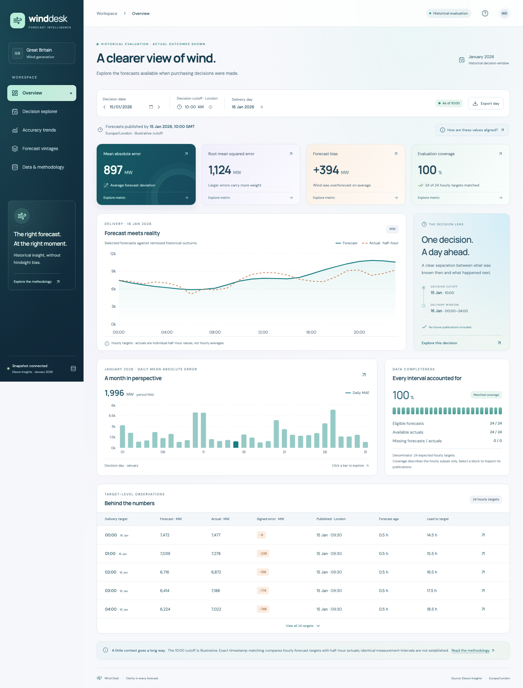

# Wind Desk

A wind forecast intelligence dashboard for exploring what was known at a purchasing decision cutoff and how those forecasts compared with historical generation.

Built with **React, TypeScript, FastAPI and Docker**, using Elexon national Great Britain wind data. The included snapshot covers decisions made **1–31 January 2026** and next-day delivery **2 January–1 February 2026**.



## Features

- **Historical evaluation** — forecast versus actual charts, daily MAE, RMSE, signed bias and coverage.
- **Decision explorer** — the latest eligible publication for each target; actual outcomes stay hidden until explicitly enabled.
- **Accuracy trends** — monthly metrics calculated from underlying observations, plus daily error and bias charts.
- **Forecast vintages** — publication history, cutoff eligibility, forecast age and lead time.
- **Metric breakdowns** — formulas, observation counts, largest misses and missing-data details.
- **Data transparency** — source provenance, snapshot checksums, quality counts and alignment explanations.
- **Practical controls** — date navigation, configurable cutoff, context-specific CSV exports and mobile layouts.

## Quick start with Docker

Install Docker Desktop with Docker Compose, then run:

```sh
git clone https://github.com/dhruv-joshi15/werool.git
cd werool
BACKEND_PORT=8001 FRONTEND_PORT=5174 docker compose --profile dashboard up -d --build
```

Open **http://localhost:5174**. The backend API is at **http://localhost:8001**, with interactive documentation at **http://localhost:8001/docs**. The saved real-data snapshot is included; no ingestion or Elexon access is required for startup. The initial image build downloads dependencies.

Check or stop the services:

```sh
docker compose ps
docker compose logs --tail=50 backend frontend
curl http://localhost:8001/api/v1/health
docker compose --profile dashboard down
```

Change `BACKEND_PORT` or `FRONTEND_PORT` if a host port is occupied. Container ports remain 8000 and 80. Compose serves data baked into the backend image, without a host bind mount. Rebuild the backend after refreshing the snapshot.

## Local development

Requirements: **Python 3.12 or 3.13**, **Node.js 22**, and npm. The commands below use a macOS/Linux shell; Windows users can use Docker Desktop or WSL.

From the repository root, start the Python backend:

```sh
python3 -m venv .venv
.venv/bin/pip install -r backend/requirements.lock.txt
cd backend
../.venv/bin/uvicorn app.main:app --reload --port 8001
```

In a second terminal, from the repository root:

```sh
cd frontend
npm ci
npm run dev
```

Open **http://localhost:5173**. Vite proxies API requests to port 8001. Stop a development server with Ctrl+C.

Alternatively, use Docker for the backend and Vite for React:

```sh
BACKEND_PORT=8001 docker compose up -d --wait backend
cd frontend
npm ci
npm run dev
```

### Configuration

See [.env.example](.env.example) and [frontend/.env.example](frontend/.env.example).

| Setting | Purpose | Default |
| --- | --- | --- |
| `BACKEND_PORT` | Compose backend host port | `8000`; examples explicitly use `8001` |
| `FRONTEND_PORT` | Compose frontend host port | `5173`; examples explicitly use `5174` |
| `CORS_ORIGINS` | Comma-separated allowed frontend origins | `http://localhost:5173` |
| `DATA_DIR` | Optional saved-snapshot directory for Python | Repository `data/` |
| `PORT` | Backend container listening port outside Compose | `8000` |
| `API_PROXY_TARGET` | Vite development API proxy target | `http://localhost:8001` |
| `VITE_API_BASE_URL` | Optional separately hosted API origin | Empty: same-origin `/api/v1` |

Compose reads a root `.env`; Vite reads `frontend/.env`. A directly launched Python server reads its shell environment rather than automatically loading `.env`. Do not commit secrets. Same-origin proxies avoid needing CORS changes for normal local/Docker use.

## Use the dashboard

Select a **decision date**, then change the **cutoff** and choose **Apply**. The delivery day is the following Europe/London calendar date.

Overview is explicitly historical evaluation. Decision explorer displays only publications available by the cutoff until **Show historical actuals** is enabled. Click metric cards for calculation details; select chart bars or target links to explore individual days and publication histories. Exports match the active view: daily observations, the full period, or target vintages. Missing values stay missing; zero generation is valid.

## Data and methodology

Application data comes only from:

- [FUELHH stream](https://bmrs.elexon.co.uk/api-documentation/endpoint/datasets/FUELHH/stream), filtered to `fuelType == WIND`.
- [WINDFOR stream](https://bmrs.elexon.co.uk/api-documentation/endpoint/datasets/WINDFOR/stream), retaining historical publication vintages.

For every target, select the maximum `publishTime` **at or before** the decision cutoff. Publications after the cutoff never enter evaluation. Default cutoff **10:00 Europe/London** is illustrative, not a verified market auction deadline.

**Important alignment limitation:** forecast targets in this snapshot are hourly. FUELHH actuals are 30-minute average MW values. Evaluation matches only exact `:00` timestamps, using the half-hour beginning then; `:30` actuals are excluded. No interpolation or averaging of adjacent actuals occurs. Equal timestamps do not establish identical measurement intervals; forecast interval semantics remain unresolved. Thus 744/744 matches mean coverage of the chosen hourly subset, not every half-hour or whole-day energy accuracy.

`Signed error = forecast MW − actual MW`: positive means overforecast. MAE, RMSE and bias use matched valid pairs; period metrics use all underlying observations. No matches return null metrics. No energy totals, customer demand, procurement quantities, trading costs or financial savings are calculated.

See [methodology](docs/methodology.md), [validation report](docs/requirements-audit.md) and [frontend API contract](docs/frontend-contract.md).

### Refresh the snapshot

Ingestion is explicit and separate from API requests. From the repository root:

```sh
cd backend
../.venv/bin/python -m scripts.ingest
```

It fetches bounded publication windows with timeouts and retries, retains raw JSON, validates WIND records, quarantines conflicts and activates a checksummed normalized snapshot only after success. No fabricated fallback is used. Network access is required. Restart the local backend or rebuild the Docker backend afterward.

`data/manifest.json` records request URLs/parameters, retrieval times, row counts, coverage, quality counts and SHA-256 identifiers. `data/raw/` preserves provenance; `data/processed/` contains the runtime snapshot. The extraction uses a bounded forecast warm-up and historical actual-publication window; later revisions and source truncation guarantees remain unresolved.

## Checks

Offline backend tests and source audits, from the repository root:

```sh
cd backend
../.venv/bin/pytest -q
../.venv/bin/python -m scripts.verify_raw_selection
../.venv/bin/python -m scripts.audit_snapshot
```

Frontend build and browser checks against the running Docker dashboard:

```sh
cd frontend
npm ci
npm run build
npx playwright install chromium
node scripts/smoke.mjs http://localhost:5174
node scripts/interactions.mjs http://localhost:5174
```

API smoke checks, from the repository root:

```sh
python3 backend/scripts/verify_api.py --base-url http://localhost:8001
```

The offline suite has 18 passing tests, including deployment snapshot packaging and isolated-path checks. Snapshot audits check all 744 default-cutoff target selections against raw records. Browser checks exercise navigation, metric dialogs, controls, charts, CSV contents, outcome isolation, error recovery and mobile layout. See [backend verification](docs/implementation-status.md) and [frontend verification](docs/frontend-status.md) for the checks actually performed and remaining limits.

## API

| Endpoint | Query / result |
| --- | --- |
| `/api/v1/health` | Service and dataset readiness |
| `/api/v1/metadata` | Scope, timezone, resolution, assumptions, quality and provenance |
| `/api/v1/decision` | `date`, optional `cutoff`; selected forecasts without actual outcomes |
| `/api/v1/evaluation` | `date`, optional `cutoff`; paired forecasts/actuals and daily metrics |
| `/api/v1/accuracy` | Inclusive `from`, `to`, optional `cutoff`; period metrics and daily breakdown |
| `/api/v1/forecast-vintages` | Timezone-aware `start_time`; saved publication history |

```sh
curl 'http://localhost:8001/api/v1/decision?date=2026-01-15&cutoff=10:00'
curl 'http://localhost:8001/api/v1/accuracy?from=2026-01-01&to=2026-01-31'
```

Timestamps serialize as UTC ISO strings; unit suffixes distinguish MW and hours. Inputs outside January 2026 or malformed cutoffs return 422. An unavailable/invalid snapshot returns 503; a valid query with no matches returns 200 with null metrics. `/docs` and `/openapi.json` expose the contract.

## Project structure

```text
backend/app/               Pure analysis, typed schemas and FastAPI endpoints
backend/scripts/           Explicit ingestion and offline source audits
backend/tests/             Deterministic synthetic tests
frontend/src/              React dashboard and typed API client
frontend/scripts/          Browser and source-verification scripts
data/raw/                  Preserved Elexon source responses
data/processed/            Content-addressed runtime snapshot
data/manifest.json         Retrieval provenance and snapshot identity
docs/                      Methodology, validation, API contract and screenshots
compose.yaml               Backend and optional dashboard services
vercel.json                Two-service frontend/API routing and build configuration
```

## Vercel deployment

Deploy this repository as a **Services** project, with **Root Directory `.`** and **Application Preset / Framework `Services`**. Do not select the root Python application, FastAPI or Vite as the project-wide preset, and do not set the project root to either subdirectory. Service-specific presets and commands are declared in `vercel.json`.

The configuration defines exactly two services:

| Service | Root | Preset | Public paths |
| --- | --- | --- | --- |
| `backend` | `backend` | FastAPI | `/api`, `/api/*`, `/docs`, `/docs/*`, `/openapi.json` |
| `frontend` | `frontend` | Vite | `/` and all remaining website paths |

Clear old project-wide install/build/output overrides from the previous single-function setup. Use Node.js 22; `backend/.python-version` selects Python 3.12. Leave `VITE_API_BASE_URL` and `DATA_DIR` unset for this configuration. React uses same-origin `/api/v1/...` requests. The public service rewrite preserves that entire path; no prefix stripping or `root_path` adjustment is needed.

No service binding is required: React runs in the browser and calls the public API; neither service makes a server-side call to the other. Runtime-only binding URLs cannot be injected into a static frontend build. See [deployment notes](docs/deployment.md) for the routing and packaging details.

Before packaging, the backend's build command stages the checksummed manifest and normalized snapshot into ignored `backend/data/`, which is explicitly included in its function bundle. No raw-source records or network ingestion are required at startup. Local Python continues to prefer the repository's source snapshot; Docker continues to use `/data`.

Verify all services locally with a current CLI (65.2.0 was tested):

```sh
npx vercel@65.2.0 dev --local --listen 127.0.0.1:3011
```

In another terminal:

```sh
python3 backend/scripts/verify_service_routes.py --base-url http://127.0.0.1:3011
python3 backend/scripts/verify_api.py --base-url http://127.0.0.1:3011
```

A cloud deployment has not been performed by this change. After importing, verify `/api/v1/health` reports `dataset_ready: true`, open `/docs`, and run browser/API checks against the deployment URL.

## AI assistance

OpenAI Codex assisted with implementation, source research, documentation and test authoring.
